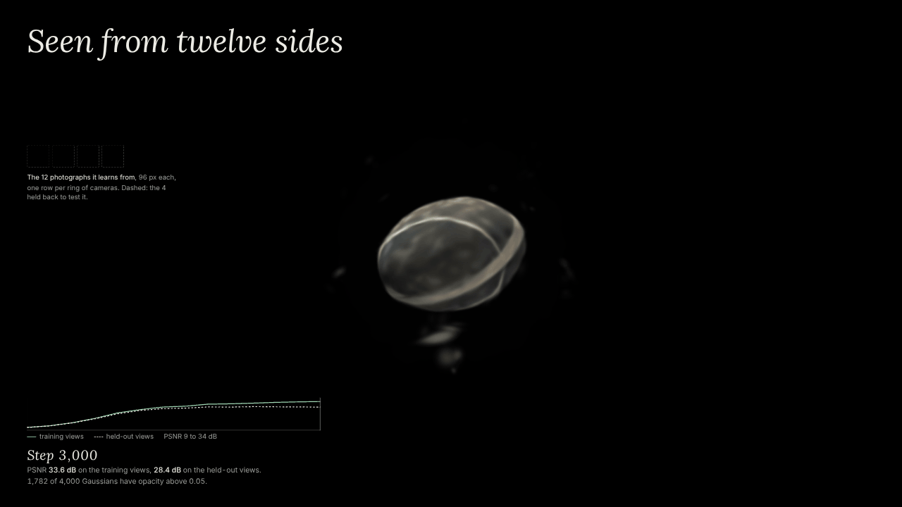

# Seen from twelve sides

[](loop/seen-from-twelve-sides-loop.mp4)

<sub>10-second loop. Click for the MP4 (1280×720, 0.45 MB); the GIF above is 1280×720, 3.7 MB.</sub>

A 3D Gaussian Splatting fit, written from scratch in NumPy and shown in the browser. Twelve rendered photographs of a procedural stone go in; a cloud of 4,000 Gaussians comes out.

The page opens on the input: the twelve photographs, one row per ring of cameras, and four dashed slots for the cameras held back. Scrub through training and watch the grey cloud become the stone, add the training cameras (each holding the photograph it took), and hold <kbd>H</kbd> to compare a held-out camera's photograph with the Gaussians rendered from the same pose, and the difference between them.

## Open it

Open `seen-from-twelve-sides.html` in a recent browser. It is a single 2.3 MB file with every training snapshot inlined; it needs an internet connection to load three.js and two fonts. If your browser blocks local files:

```bash
python3 -m http.server 8000   # then open http://localhost:8000/seen-from-twelve-sides.html
```

| Control | What it does |
|---|---|
| Play button / scrubber | training from step 0 to 3,000; between logged steps the view eases, and the numbers always belong to the logged step |
| **Add the cameras** | the 12 training cameras (jade, each holding its photograph) and the 4 held-out cameras (white) |
| **Compare a held-out view** (hold <kbd>H</kbd>) | photograph, render from the same pose, and their difference ×4, at whole multiples of 96 px |
| **How it works** | the method, the numbers and what this is not |
| Drag or arrow keys / scroll | orbit / zoom |

`prefers-reduced-motion` starts on the final step, with no spin and no autoplay.

## Method

- **The photographs** (`code/scene.py`). The stone is a signed distance function: a tilted ellipsoid pushed around by two octaves of noise, with a quartz band and speckles, and lighting baked into its colour. A NumPy sphere tracer renders it at 96×96 px from 16 cameras: 12 training cameras in three rings of four, and 4 between them that the fit never sees.
- **The Gaussians.** 4,000, starting as faint, nearly grey blobs in a ball. Each has 14 numbers: position, three scales, a rotation (quaternion), a colour and an opacity. Colour does not depend on view direction (no spherical harmonics). None is ever added (no densification), so every snapshot holds the same 4,000 and the scrubber can ease between them.
- **The rasterizer** (`code/gs.py`). Each Gaussian is projected to a 2D ellipse with the EWA splatting approximation (Zwicker, Pfister, van Baar & Gross 2001), plus a 0.3 px dilation taken from the reference 3DGS code. The image is split into 16×16 tiles, and each tile alpha-composites its Gaussians front to back.
- **The backward pass** is derived by hand, through the blending, the conic, the projection, the covariance and the quaternion. `code/gradcheck.py` compares it with central differences in float64: worst relative error **1.9e-8**.
- **Training** (`code/train.py`). L1 loss over a random solid background each step (so empty space has to become transparent), Adam with per-parameter decaying learning rates, one random training photograph per step, 3,000 steps. Every 300 steps from 300 to 2,400, Gaussians below opacity 0.005 are switched off for good (2,082 by the end, 1,523 of them before step 1,200); every opacity is cut back once, at step 1,200. Training took 26 minutes of wall time on two shared CPU cores.
- **The page** draws each Gaussian as an instanced three.js quad: the vertex shader projects the covariance with the same Jacobian and dilation, the fragment shader evaluates the Gaussian, and quads are sorted back to front on the CPU when the view or the snapshot changes.

## Numbers

| step | train PSNR (12 views) | held-out PSNR (4 views) | opacity > 0.05 |
|---:|---:|---:|---:|
| 0 | 9.70 | 9.61 | 4,000 |
| 200 | 26.06 | 25.32 | 1,174 |
| 1,000 | 31.51 | 28.45 | 1,427 |
| 1,500 | 32.05 | **28.91** (best) | 1,721 |
| 3,000 | **33.60** | **28.45** | 1,782 |

PSNR is over the whole 96×96 image on a black background, where the stone covers only about 45% of the pixels. Counting stone pixels only, step 3,000 scores 31.9 dB on the training views and 27.2 dB on the held-out views. The held-out views are a validation set (they helped choose which of two runs to ship), not an untouched test set.

## What comes from 3DGS, and what does not

From *3D Gaussian Splatting for Real-Time Radiance Field Rendering* (Kerbl, Kopanas, Leimkühler & Drettakis, ACM TOG 42(4), SIGGRAPH 2023): the representation, Σ = R S Sᵀ Rᵀ, the EWA projection (which 3DGS takes from Zwicker et al. 2001), the 0.99 opacity clamp and the 1/255 cutoff, 16×16 tiles, depth-sorted compositing, the activations, Adam with a decaying position learning rate, the opacity reset and the pruning of near-transparent Gaussians. 3DGS resets opacity periodically (every 3,000 iterations, alongside densification); this run resets once and prunes on its own schedule.

Written for this piece, with Claude: the NumPy rasterizer, the backward pass and its gradient check, the procedural stone and its renderer, the fixed-count design that makes snapshots interpolable, the schedule, and the three.js page.

Left out compared with the paper: structure-from-motion initialisation, densification, spherical harmonics, the D-SSIM term, CUDA, and real image sizes (96 px here, against 1–2 megapixels).

## Limits

- The gap between 33.6 dB on the training views and 28.4 dB on the held-out views is overfitting to twelve photographs; held-out PSNR peaks at step 1,500 and then drifts down a little.
- A few blobs float beside the stone. Each of the 48 visible ones is out of frame in at least 6 of the 12 training cameras. Of the 228 times one falls inside a training camera's frame, the stone is in front of it and hides it 187 times, it sits in front of the stone 38 times, and only 3 times is it against empty background. So almost no photograph contradicts them. More or wider cameras should remove them (not tested).
- The photographs are synthetic, perfectly posed and lit the same in every view. Real captures need camera poses from structure from motion, view-dependent colour and far more Gaussians.
- One run per setting and one seed: differences of a few tenths of a dB are not evidence either way.
- The scrubber's in-between frames are interpolated, not real training states.

## Run the training

Needs Python 3 and NumPy.

```bash
cd code
python3 scene.py          # the 16 photographs -> data/gt.npz
python3 gradcheck.py      # -> data/gradcheck.json
python3 train.py --fresh --prune 0.005 --reset 1200   # -> data/log.json, data/snaps/
```

Training is resumable (`ckpt/latest.npz`, every 250 steps). The script that packs the snapshots into the page, and the Playwright check, are not in this repository yet.

## In this repository

- `seen-from-twelve-sides.html`: the piece
- `code/`: the scene, the rasterizer with its backward pass, the gradient check and the trainer
- `screenshots/`: the cameras, a held-out comparison, and the phone layout
- `loop/`: the loop video, its GIF and a poster

## Credits and license

3D Gaussian Splatting: Kerbl, Kopanas, Leimkühler & Drettakis, SIGGRAPH 2023. EWA splatting: Zwicker, Pfister, van Baar & Gross, 2001. three.js is MIT; the fonts are under the SIL Open Font License.

Code: MIT. See [LICENSE](LICENSE).

Built with Claude for Joe Gao.
